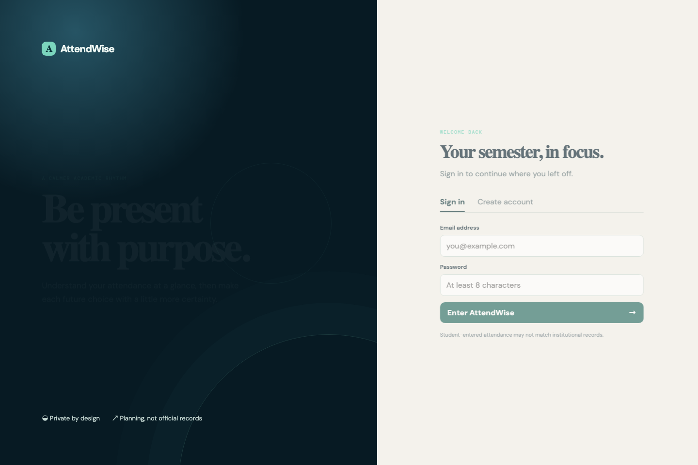
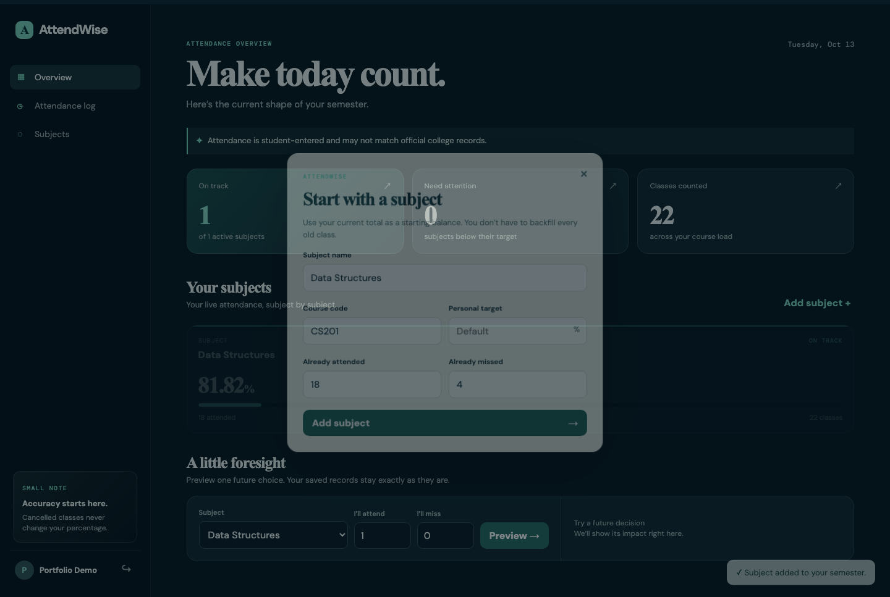
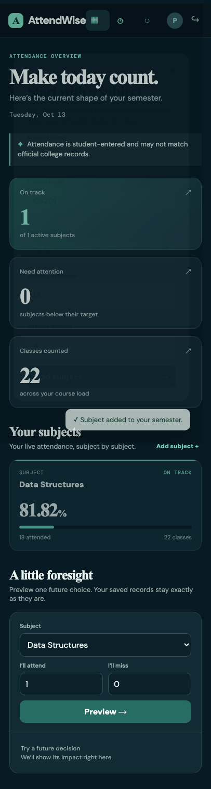

# AttendWise

> A calm, student-first attendance planner for understanding the present and confidently planning the next class.

[](backend/)
[](frontend/)
[](https://www.framer.com/motion/)
[](backend/tests/)

AttendWise helps students log class attendance, understand which subjects need attention, and explore future decisions before committing them. It is a personal planning tool—not an official institutional attendance record.

## Why AttendWise?

College attendance portals typically stop at a static percentage. AttendWise adds the questions students actually need answered:

- What is my attendance by subject right now?
- Which subject needs attention first?
- If I attend or miss upcoming classes, where will that leave me?
- How many consecutive classes do I need to attend to recover?

The answer is a focused full-stack app with safe, server-calculated planning tools.

## Product preview

| Sign in | Desktop dashboard |
|---|---|
|  |  |

<p align="center">
  
</p>

## Features

- Secure registration and login with Argon2 password hashing and JWT sessions
- Subject management with an optional per-subject attendance target
- Attendance register supporting attended, absent and cancelled classes
- Duplicate protection for the same subject, date and session label
- Live dashboard with percentages, totals and understandable risk states
- Read-only what-if planner—projections never write to the attendance register
- Recovery calculation and safe-absence planning estimates
- Responsive React interface with Framer Motion transitions, animated progress values, modals and toast feedback

## Architecture

```text
React + Vite + Framer Motion
             │
             ▼
 FastAPI /api/v1 routes
             │
             ▼
 Service layer (attendance, risk, planner)
             │
             ▼
 SQLAlchemy models → SQLite (portable to PostgreSQL)
```

The backend owns all calculations and ownership checks. The frontend never treats its own calculations as a source of truth.

## Tech stack

| Area | Choice |
|---|---|
| Frontend | React, Vite, Framer Motion, custom CSS |
| Backend | FastAPI, Pydantic, SQLAlchemy |
| Data | SQLite, designed for PostgreSQL portability |
| Security | Argon2 via `pwdlib`, JWT bearer tokens |
| Quality | Pytest service tests and browser screenshots with Playwright |

## Run locally

### 1. Start the API

```bash
cd backend
python3 -m venv .venv
source .venv/bin/activate
pip install -r requirements.txt
cp .env.example .env
uvicorn app.main:app --reload
```

The API documentation is available at `http://127.0.0.1:8000/docs`.

### 2. Start the frontend

```bash
cd frontend
npm install
npm run dev
```

Open the URL Vite prints (normally `http://localhost:5173`).

## Test and build

```bash
# Backend tests
cd backend
.venv/bin/pytest -q

# Production frontend build
cd ../frontend
npm run build
```

## Project layout

```text
.
├── backend/     # FastAPI app, database models, services and tests
├── frontend/    # React/Vite user interface and Framer Motion interactions
└── report/      # AAT-1 project report, source, PDF, DOCX and verified screenshots
```

## Key attendance rules

- **Attendance %** = attended / counted classes × 100
- **Cancelled classes** are excluded from counted classes.
- **Recovery** uses `ceil((r × T − A) / (1 − r))`, where `r` is the target as a decimal.
- **Simulation** is intentionally read-only: it returns a projection and does not create attendance rows.

## Documentation

- [Project report (PDF)](report/AttendWise_Project_Report.pdf)
- [Project report (DOCX)](report/AttendWise_Project_Report.docx)
- [Backend setup notes](backend/README.md)
- [Frontend setup notes](frontend/README.md)

## Scope note

AttendWise is deliberately limited to student-entered planning. It does not include college ERP integration, faculty entry, biometrics, location tracking or multi-role administration.

---

Built as a portfolio-driven full-stack project for AAT-1.
